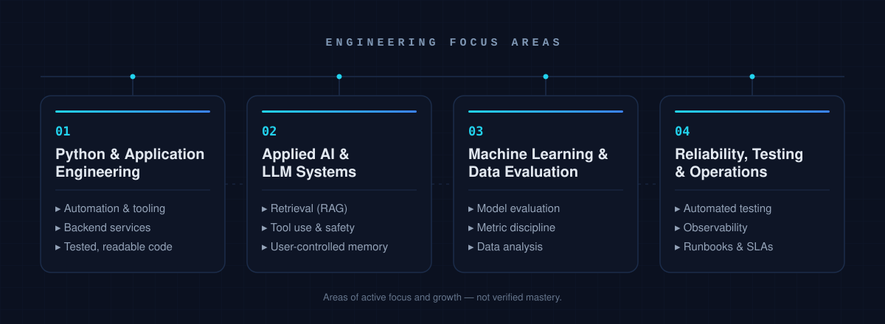

<p align="center">
  
</p>

<p align="center">
  <strong>Operations &amp; Support professional building reliable, tested software with Python and applied AI/ML.</strong>
</p>

---

## Introduction

I work in Amazon Operations/Support, where problems arrive ambiguous and systems have to keep running. That work taught me to value clear diagnostics, predictable behaviour and tools people can genuinely trust — the same instincts I now bring to building software.

I am moving from operations into **applied AI/ML engineering**: writing Python applications, automating repetitive work, and building AI-enabled tools that are grounded, testable and honest about what they can do. The goal is useful, reliable software — not demos.

---

## Engineering focus

<p align="center">
  
</p>

---

## Technical focus

Grouped by where each skill actually stands today — not by aspiration.

**Working with regularly** — everyday tools in real work

`Python` · `Git` · `GitHub` · `Automation` · `Testing` · `Debugging`

**Building with** — applied in current project work

`Backend APIs` · `Databases` · `LLM integration` · `Retrieval (RAG)` · `Tool use` · `Configuration management`

**Learning &amp; exploring** — study and early experiments

`Machine learning` · `Model evaluation` · `Data analysis` · `Evaluation harnesses` · `Observability for AI`

> A technology moves from *learning* to *building with* only after I have implemented and tested something real with it. Planned use is not proficiency.

---

## Projects

Four applications in active development: two apply AI, two are deliberately deterministic and AI-free. Everything stays marked **IN DEVELOPMENT** until tested functionality exists.

### AEGIS AI · `IN DEVELOPMENT`

A JARVIS-inspired personal assistant.

- **Purpose** — a conversational assistant that stays under the user's control.
- **Core functionality** — conversational AI, safe tool execution, document search, and user-controlled memory.
- **Classification** — AI-powered.
- **Stack** — Python with configurable LLM integration *(planned)*.
- **Repository** — not published yet.

### DOCUMIND AI · `IN DEVELOPMENT`

A document intelligence application with grounded retrieval.

- **Purpose** — turn a pile of documents into answerable, evidence-backed knowledge.
- **Core functionality** — process documents, retrieve relevant evidence, and answer questions with citations.
- **Classification** — AI-powered.
- **Stack** — Python with configurable LLM integration *(planned)*.
- **Repository** — not published yet.

### SENTINEL · `IN DEVELOPMENT`

A cybersecurity log analyzer that explains every alert.

- **Purpose** — surface real security signal from raw logs without a black box.
- **Core functionality** — deterministic rules, event correlation, and evidence-backed alerts.
- **Classification** — no AI or machine learning, by design. Every alert traces to an explicit, inspectable rule.
- **Stack** — Python.
- **Repository** — not published yet.

### OPSFLOW · `IN DEVELOPMENT`

An operations and SLA management application.

- **Purpose** — run operational workflows and SLAs with clear, predictable rules.
- **Core functionality** — persistent tickets, configurable workflows, escalation rules, and operational analytics.
- **Classification** — no AI or machine learning, by design.
- **Stack** — Python with persistent storage *(planned)*.
- **Repository** — not published yet.

Repository links, screenshots and demos will be added to each project only once the repository exists and the functionality is verified.

---

## Engineering principles

- **Real functionality over mockups** — if it is not implemented and tested, it is labelled as in development.
- **Testing and reproducibility** — deterministic behaviour and automated tests before any claim.
- **Clear documentation** — systems another engineer can understand and operate.
- **Secure configuration and responsible data handling** — secrets stay out of code; user data is handled deliberately.
- **Measured results over unsupported claims** — metrics are reported only when actually measured.
- **Learning through implementation** — skills are earned by shipping, not by listing.

---

<details>
<summary><strong>Signature</strong></summary>

```text
#  nikhis-s  ──────────────────────────────────────
#  focus   : reliable, tested software
#  path    : operations  →  Python  →  applied AI / ML
#  method  : build it, test it, measure it, document it
#  rule    : no claim without evidence
```

</details>

---

## Contact

Open to conversations about software engineering and applied AI/ML roles.

- **GitHub** — [github.com/nikhis-s](https://github.com/nikhis-s)

Additional contact details will be added here only if verified and provided.
