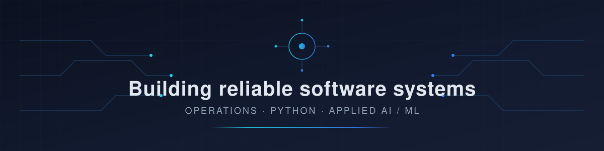

  

<h1 align="center">nikhis-s</h1>

  <strong>Operations &amp; Support professional building toward AI/ML engineering</strong>

---

## Introduction

I work in Amazon Operations/Support, where I spend my days solving real problems under real constraints: ambiguous requests, incomplete information, and systems that have to keep running. That experience shapes how I build software — I care about reliability, clear diagnostics, and tools that people can actually trust.

I am now focused on turning that operational instinct into engineering practice: Python application development, automation of repetitive work, applied AI and LLM-powered tools, and disciplined software design. My goal is to build useful, reliable software — not demos.

---

## Technical direction

Skills and technologies are grouped honestly by where they currently stand.

### Working with regularly
- **Python and software engineering** — scripting, automation, structured application code, debugging
- **Testing, reliability and automation** — test-first habits, deterministic behaviour, reducing manual toil

### Actively building with
- **Backend APIs and databases** — service design, persistent storage, configuration management
- **Applied AI and LLM applications** — conversational interfaces, retrieval over documents, tool-use patterns, user-controlled memory

### Currently learning and exploring
- **Machine learning and data analysis** — model evaluation, feature thinking, honest metric reporting
- **Production AI patterns** — evaluation harnesses, safe tool execution, observability for AI features

I do not claim proficiency in a technology because a planned project mentions it. Skills move from "learning" to "building with" only after I have implemented and tested something real.

---

## Projects

Four applications are in active development. Two apply AI; two are deliberately AI-free, deterministic systems. Each will stay honestly labelled until real, tested functionality exists.

### AEGIS AI IN DEVELOPMENT
A JARVIS-inspired personal assistant. Planned capabilities include conversational AI, safe tool execution, document search, and user-controlled memory. The emphasis is on giving the user explicit control over what the assistant remembers and what actions it can take.

### DOCUMIND AI IN DEVELOPMENT
A document intelligence application. It will process documents, retrieve relevant evidence, and answer questions using configurable AI integration, so the underlying model can be swapped or upgraded without rewriting the application.

### SENTINEL IN DEVELOPMENT
A Python cybersecurity log analyzer. It uses deterministic rules, event correlation, and evidence-backed alerts. Sentinel contains no AI or machine learning by design — every alert traces to explicit, inspectable rules.

### OPSFLOW IN DEVELOPMENT
An operations and SLA management application. Planned features include persistent tickets, configurable workflows, escalation rules, and operational analytics. Like Sentinel, it is deliberately deterministic — no AI or ML.

Repository links, screenshots, and demos will be added here only once the corresponding repositories exist and the functionality is verified.

---

## Current focus

My transition from Amazon Operations/Support into applied AI/ML engineering is underway. Day to day, that means:

- Shipping practical Python systems with real persistence and tests
- Building LLM-powered features with retrieval, tool use, and user-controlled memory
- Studying machine learning fundamentals and evaluating models with measured results
- Applying operational discipline — runbooks, escalation logic, SLA thinking — to software I design

---

## Engineering principles

- **Real functionality over mockups.** If it is not implemented and tested, it is labelled as in development.
- **Testing and reproducibility.** Deterministic behaviour and automated tests before claims.
- **Clear documentation.** Code and systems that another engineer can understand and operate.
- **Secure configuration and responsible data handling.** Secrets stay out of code; user data is handled deliberately.
- **Measured results over unsupported claims.** Metrics are reported only when they have been actually measured.
- **Learning through implementation and iteration.** Skills are earned by shipping, not by listing.

---

## Contact

I am open to conversations about software engineering and applied AI/ML roles. You can reach me through my [GitHub profile](https://github.com/nikhis-s).
